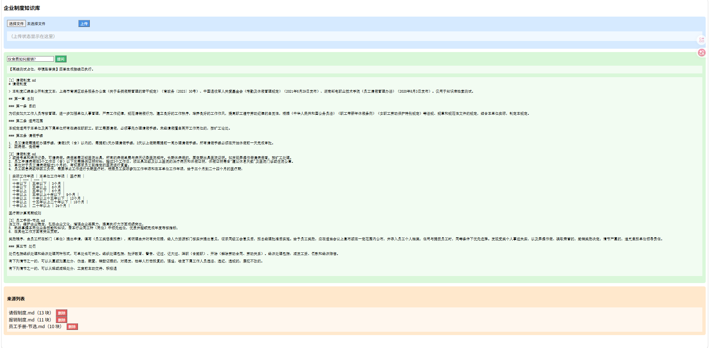
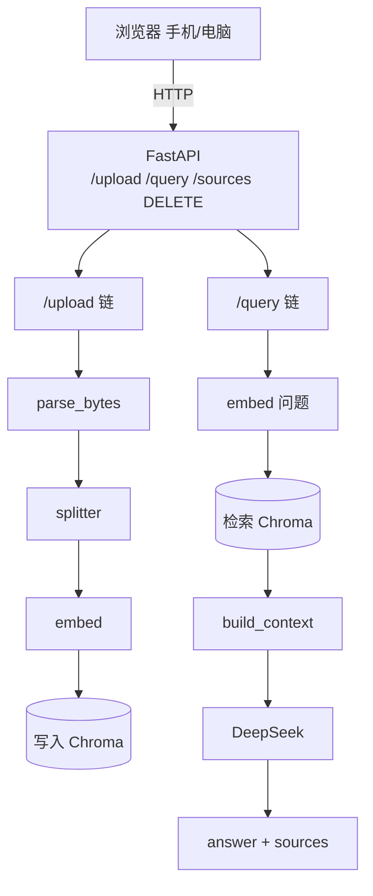

# rag-kb · 企业制度知识库（项目②，毕设 #91 同源）

RAG 知识库问答系统，包含文档处理、向量检索、带引用问答、上传与来源管理、评估和网页入口。当前阶段与验收状态只看 [当前任务](../../handbook/07-当前任务指令.md)。

## 文件地图（找函数先看这张表）

| 文件 | 关键函数 / 内容 | 同目录依赖 | 状态 |
|---|---|---|---|
| `loader.py` | `load_documents()` 读 `data/`；`clean_text()` 清洗（统一换行 / 去首尾空白 / 压空行） | — | ✅ W9 |
| `splitter.py` | `split_text(text, chunk_size, overlap)` 切块 + 参数守卫 | `loader`（演示用） | ✅ W9 |
| `run_experiments.py` | 切分对比实验（chunk_size / overlap 各三档） | `loader` `splitter` | ✅ W9 |
| `experiments.md` | 实验记录：数字与结论都在这（W12 评估集要引用） | — | ✅ W9–W10 |
| `embed_test.py` | 最小脚本：DashScope `text-embedding-v4` 拿一条 1024 维向量 | — | ✅ W10 |
| `retriever.py` | `embed()` 向量化 / `cos_sim()` 余弦 / `retrieve()` 手写 top-k（含 `min_score`、`source_filter`；chunks 为 `{"source","text"}` 列表） | `loader` `splitter` | ✅ W10–W12 |
| `chroma_store.py` | `build_collection()` Chroma 建库 + 查询（与手写版对照 10/10 一致） | `loader` `splitter` `retriever` | ✅ W10 |
| `qa.py` | `build_index()` / `retrieve_hits()` / `build_context()` / `ask()`：检索 → 拼材料 → DeepSeek 回答 | `loader` `splitter` `retriever` | ✅ W11 |
| `eval_questions.md` | 评估集 20 题（开发 12 + 留出 8）+ 判定列 | — | 🔄 W12 |
| `eval_run.py` | 读评估集 → 逐题检索 top-3 → 统计「开发集 X/Y」 | `loader` `qa` | 🔄 W12 |
| `reference/` | 参考答案（卡住 25 分钟以上再看）：`loader_reference.py` / `splitter_reference.py` | — | — |
| `failure-cases.md` | **真实失败案例 4 条**（同名坏文件毁好文件 / 护栏丢失 `k=0` 打到 Chroma / 同一个值散在 6 个文件里 / 假真向量库共用一个目录）：现象 → 根因 → 修法 → 怎么验证 | — | ✅ W15 |
| `practice/` | **W9-W15 的小练习**（`id_practice*.py` / `blocks_per_source.py` / `max_key_practice.py` / `build_context_practice.py`），全部自足无 import，可独立跑 | — | — |
| `data/` | 语料：5 份企业制度 `.md`（员工手册节选 / 考勤 / 报销 / 请假 / 安全） | — | ✅ W9 |

**依赖关系**（`embed()` 是唯一的向量化入口，`chroma_store` / `qa` 都复用它）：

```
loader.py        （最底层，无内部依赖）
splitter.py      ← loader
retriever.py     ← loader, splitter
chroma_store.py  ← loader, splitter, retriever
qa.py            ← loader, splitter, retriever
eval_run.py      ← loader, qa
```

> 脚本之间用「同目录直呼其名」互相 import（如 `from loader import load_documents`）—— Python 会把脚本所在目录加进模块搜索路径，所以不用写包名。

## 在 VS Code 里快速找代码

- 光标放函数名上按 **`F12`** → 跳到定义处（例：`from retriever import embed` 里的 `embed` 就跳去 `retriever.py`）
- **`Ctrl+T`** → 全仓库搜函数名 / 类名
- **`Ctrl+Shift+O`** → 列出当前文件所有函数，直接跳
- 看 import 行就知道函数住哪：`from splitter import split_text` → `split_text` 在 `splitter.py`

## 数据与索引（10-26 重构）

**当前 Web / Agent 的语料、索引、上传和成本日志路径由 `config.py` 按文件位置推算。** 换机器后仍需安装依赖、配置密钥；旧实验与参考脚本中的历史路径不代表当前入口。

| 位置 | 内容 | 是否入库 |
|---|---|---|
| `data/*.md` | 语料（制度原文） | ✅ 入库 |
| `data/index/` | 正式索引（Chroma），由 `data/*.md` 派生 | ❌ gitignore，可重建 |
| `data/_lab/` | 测试/练习用临时库 | ❌ gitignore |
| `data/uploads/` | 网页上传文件落地 | ❌ gitignore |
| `logs/cost_log.jsonl` | 花费日志 | ❌ gitignore（`*.jsonl`） |

**索引是派生数据，不进 git。** 当前 `search_kb` 和 Web `/query` 在空库时调用重建；`/sources`、删除接口和其他演示入口不承诺自动重建。也可显式调用：

```python
from index_store import ensure_index
import config

ensure_index(config.INDEX_PATH, config.DATA_DIR)  # 空则重建，非空直接返回
```

`ensure_index` 返回块数：非空直接返回，空库只从 `data/` 顶层的 `.md` 重建；找不到 `.md` 时抛可读的 `ValueError`。它不校验非空库是否完整，也不自动恢复只存在于 `data/uploads/` 的上传文件。首次重建使用真实入口时会调用付费 embedding。

## 怎么跑（在仓库根目录）

```powershell
uv run python projects\rag-kb\loader.py           # 加载 + 清洗（免 key）
uv run python projects\rag-kb\run_experiments.py  # 切分对比实验（免 key）
uv run python projects\rag-kb\embed_test.py       # 单条向量 1024 维
uv run python projects\rag-kb\retriever.py        # 手写检索 top-k
uv run python projects\rag-kb\chroma_store.py     # Chroma 检索对照
uv run python projects\rag-kb\qa.py               # 端到端问答（W11）
uv run python projects\rag-kb\eval_run.py         # 评估集跑分（W12）
```

> 需要 key 的：`embed_test` / `retriever` / `chroma_store` / `qa` / `eval_run`（`.env`：DashScope 向量化 + DeepSeek 生成）。

## 网页版（W14）

浏览器里上传制度、提问、看引用来源、管理来源列表。

```powershell
uv sync                                                                 # 装依赖
uv run uvicorn api_lab:app --port 8765 --app-dir projects\rag-kb       # 起服务（离线假向量）
```

然后浏览器打开 **http://127.0.0.1:8765/**。



- `api_lab:app` 用**离线假向量 + 假模型回复**，只验证页面接线，**不花钱、也不证明检索质量**。
- 要用真实模型：把 `.env` 的 key 配好，起 `uv run uvicorn api:app --port 8765 --app-dir projects\rag-kb`（**真实 embedding 与生成都是付费调用**）。
- **不能用 VS Code Live Server 打开页面** —— 页面要调 `/sources`、`/query` 这些后端接口，必须从 uvicorn 的地址进（同源）。

| 接口 | 作用 |
|---|---|
| `POST /upload` | 上传 `.md` / `.pdf`，入库 |
| `POST /query` | 提问，返回答案 + 引用片段 |
| `GET /sources` | 列出库内来源与块数 |
| `DELETE /source/{name}` | 删除某个来源 |

## 架构图



> 索引目录由启动哪个入口决定：`api_lab` → `data/_lab/index_offline/chroma_index/`（3 维假向量），`api` → `data/index/chroma_index/`（1024 维真向量）。图上两个框表示「写」和「读」两种动作，不是两个库。

> `answer` 与 `sources` 共用同一次检索结果：`hits` 只检索一遍，既拼进 `build_context` 的参考材料交给模型，又原样作为 `sources` 返回，所以两者是同一批片段 —— 这就是引用可溯源。

## 局域网访问（手机 / 其他电脑）

```powershell
uv run uvicorn api_lab:app --host 0.0.0.0 --port 8765 --app-dir projects\rag-kb
```

- `127.0.0.1`：只服务本机；`0.0.0.0`：监听所有网卡。后者是绑定标记，不能直接当访问地址。
- 查 IP 用 `ipconfig`：只认 WLAN 的 `<你的 WLAN IP>`；`198.18.0.x`（代理）和 `192.168.190.x` / `192.168.80.x`（VMware 虚拟网卡）都不要用。
- 防火墙：python.exe 已有 Public 档入站放行（实际命中的是 `uv\python\cpython-3.13.15` 那条）。规则绑定具体 Python 路径，换版本后需要重新放行。
- 手机访问：`http://<电脑IP>:8765/`，需同时满足 `--host 0.0.0.0`、同一 WiFi、防火墙放行。

## 已知限制

1. 只支持.md和.pdf文件的上传，上传其他类型文件会抛出错误。
2. 没有权限鉴别或身份认证功能，任何用户在访问的时候都能够自由上传及删除文件。
3. 问答每一轮对话都不会带上上下文，每轮对话AI都没有记忆。
4. 前端只处理了 HTTP 错误（4xx/5xx），未捕获网络层异常；服务未启动或断网时点击无任何反馈。
